  

    

  

   

  

    
    
    
    
    
  

---

### `01 //` About Me

I'm **Yafy Habibi**, a Full-Stack Developer and Informatics Engineering student at the **Electronic Engineering Polytechnic Institute of Surabaya (PENS)**, based in **Probolinggo, Indonesia**.

I enjoy turning messy real-world constraints into clean, reliable software — from **modern Next.js & TypeScript interfaces** to **Google OR-Tools CP-SAT scheduling engines**, **FastAPI backends**, and **zero-dependency Linux terminal tools**.

- 🔭 **Currently building:** Automated academic scheduling (**CampusFlow**), adaptive production recovery (**SetRescue AI**), and pure-Bash CLI tooling (**pomo**).
- 🧪 **Exploring:** Mathematical optimization (`OR-Tools`), applied AI workflows, and quantum circuits with **Qiskit**.
- 🖥️ **Daily driver:** Linux (Arch / Hyprland), Neovim, tmux, and Waybar.
- ⚡ **Fun fact:** I love replacing bloated GUIs with tiny, fast scripts and clean keyboard-driven workflows.

---

### `02 //` Tech Stack & Tooling

  
<strong>Core Languages &amp; Frameworks</strong>

  

    

  
<strong>Backend, Data &amp; Environment</strong>

  

    

  

    
    
    
    
  

---

### `03 //` Featured Projects

<table>
  <tr>
    <td width="50%" valign="top">
      <h4>📅 <a href="https://github.com/Yapidev/kampus-scheduler">CampusFlow</a></h4>
      
Automated campus course scheduling engine powered by <strong>Google OR-Tools CP-SAT</strong> with best-fit room capacity, anti-gap compaction, and utilization analytics.

      
<code>Python</code> · <code>OR-Tools</code> · <code>Optimization</code>

    </td>
    <td width="50%" valign="top">
      <h4>🎬 <a href="https://github.com/Yapidev/SetRescue-AI">SetRescue AI</a></h4>
      
Local-first production readiness &amp; adaptive recovery platform for production managers combining incident modeling with verified schedule recovery.

      
<code>React</code> · <code>TypeScript</code> · <code>FastAPI</code> · <code>SQLite</code> · <code>OR-Tools</code>

    </td>
  </tr>
  <tr>
    <td width="50%" valign="top">
      <h4>⏱️ <a href="https://github.com/Yapidev/pomo">pomo</a></h4>
      
A sleek pure-Bash terminal Pomodoro timer with block-digit animations, themes, <code>tmux</code>/<code>waybar</code> status bar mode, and privacy-first Hyprland/Sway activity recaps.

      
<code>Bash</code> · <code>Linux</code> · <code>Hyprland</code> · <code>CLI</code>

    </td>
    <td width="50%" valign="top">
      <h4>✅ <a href="https://github.com/Yapidev/todoodoong">Todoodoong</a> · <a href="https://todoodoong.vercel.app">Live Demo ↗</a></h4>
      
Offline-first Kanban &amp; task PWA with accessible <code>@dnd-kit</code> drag-and-drop, switchable Kanban/Table/List/Checklist views, and cross-tab sync.

      
<code>Next.js 16</code> · <code>React 19</code> · <code>TypeScript</code> · <code>Tailwind v4</code>

    </td>
  </tr>
  <tr>
    <td width="50%" valign="top">
      <h4>🌐 <a href="https://github.com/Yapidev/Portfolio">Developer Portfolio</a> · <a href="https://portfolio-amber-nine-64.vercel.app">Live Site ↗</a></h4>
      
Personal portfolio showcasing web engineering work including Hummatask, Metrix for Education, Konsera, and PKL Hummatech.

      
<code>Next.js</code> · <code>TypeScript</code> · <code>Framer Motion</code> · <code>Tailwind</code>

    </td>
    <td width="50%" valign="top">
      <h4>⚛️ <a href="https://github.com/Yapidev/qiskit-praktikum">Qiskit Praktikum</a></h4>
      
Quantum computing experiments implementing Bell states and the Deutsch-Jozsa algorithm across local simulators and real IBM Quantum hardware.

      
<code>Python</code> · <code>Qiskit</code> · <code>Quantum Computing</code>

    </td>
  </tr>
</table>

---

### `04 //` GitHub Analytics

  
  

    

  

    

  

 

  

